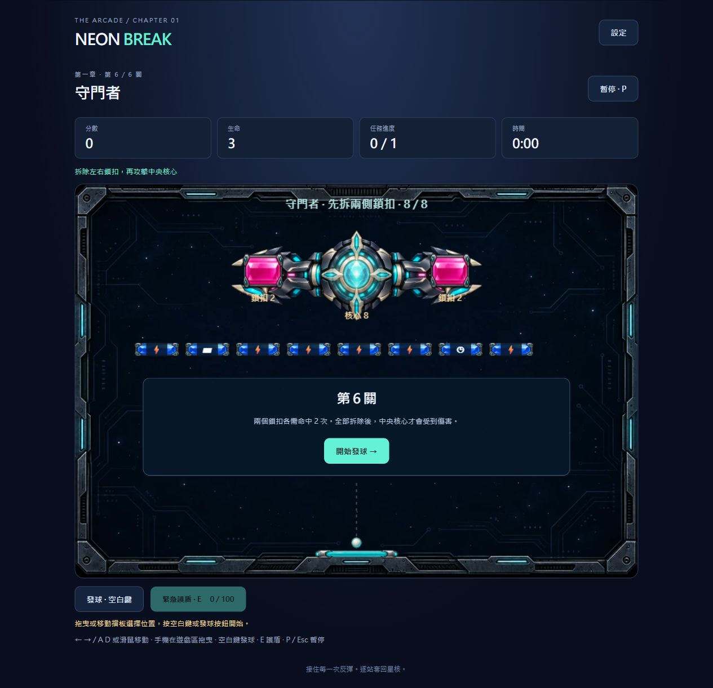

# 第一個里程碑：第一章可玩版本

已完成：標題選單、六關章節地圖、關卡詳情與教學、守門者 Boss、
四種道具（加長、三重球、緩速、底部護罩）、緊急護盾、
音效與背景旋律、星等結算、首次研究點獎勵、本機存檔與設定。

關卡依序解鎖。每關三次生命；掉命保留已破壞目標，重試還原整關。
第 3 關提供護盾教學與 50 起始能量，通關後永久解鎖。
守門者兩側鎖扣各需兩次命中，中央核心解除防護後需八次命中。
首次完成和首次提升星等才發放研究點，目前不包含研究升級介面。

操作：方向鍵／A D、滑鼠或遊戲區拖曳移動；空白鍵發球；
E 護盾；P／Esc 暫停。手機有獨立發球、技能與暫停按鈕。
可設定音量、音樂、接球輔助和降低特效。

## 驗證

- `node tests/campaign.cjs`：關卡佈局、解鎖、星等、獎勵去重、
  存檔驗證與球反彈。
- `node tests/game.cjs`：六關流程、Boss 鎖扣保護、四道具、
  護盾救球、暫停倒數、掉命、結算、存檔失敗、圖片載入重試。
- 使用自動擋板控制器經實際物理碰撞完成六關，沒有直接清除目標；
  測試配置下各關約 63、66、60、48、44、32 秒。這是可達性測試，
  不是玩家通關時間或正式難度平衡結果。
- 瀏覽器實際檢查選單、地圖、第一關發球與掉命，控制台無錯誤。
- 390 × 844 窄螢幕預覽無水平溢出，發球與技能按鈕高度 48 px。
  實體手機觸控手感及長時間效能仍需玩家試玩。

## 素材與聲音

沿用既有 PNG／WebP 素材。守門者採用 Codex native image_gen
生成的透明圖；原圖在 `assets/source/guardian.png`，
遊戲圖在 `assets/guardian.png`，描述在 `artwork/guardian-prompt.txt`。
實際生成模型及費用未由工具提供。音效與旋律由 Web Audio 產生，
首次互動後啟用，失去焦點後停止並暫停遊戲。

## 存檔與後續

進度位於此瀏覽器的 localStorage，鍵名 `neon-break-campaign-v1`。
完成關卡才保存紀錄，重開時回到關卡準備；沒有跨裝置同步。
六關通關後可重玩所有關卡及 Boss，挑戰個人最高分與三星。
後續里程碑才加入研究升級、第二到第五章與其他挑戰模式。

本機預覽：`node dev-server.cjs`，開啟 `http://127.0.0.1:8891/`。

